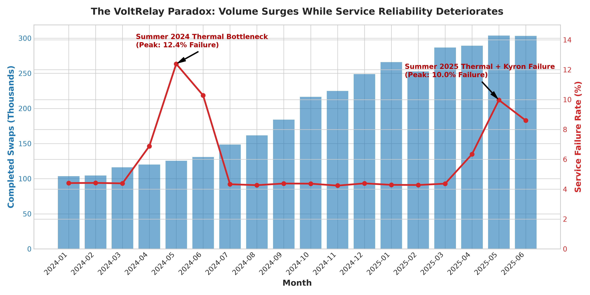
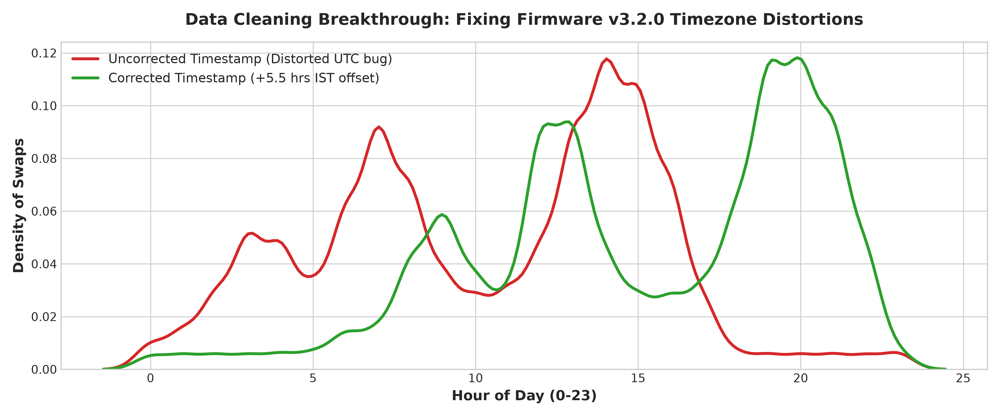
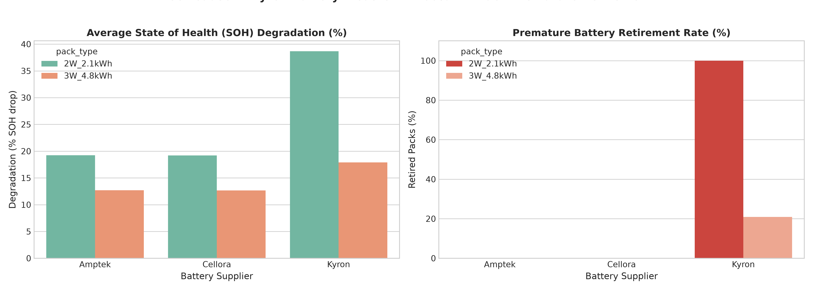
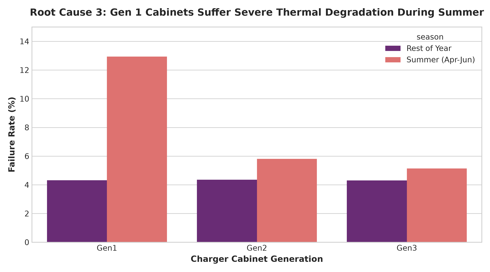
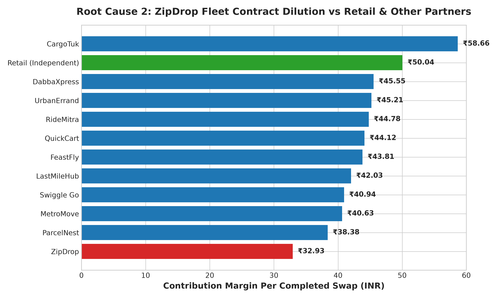
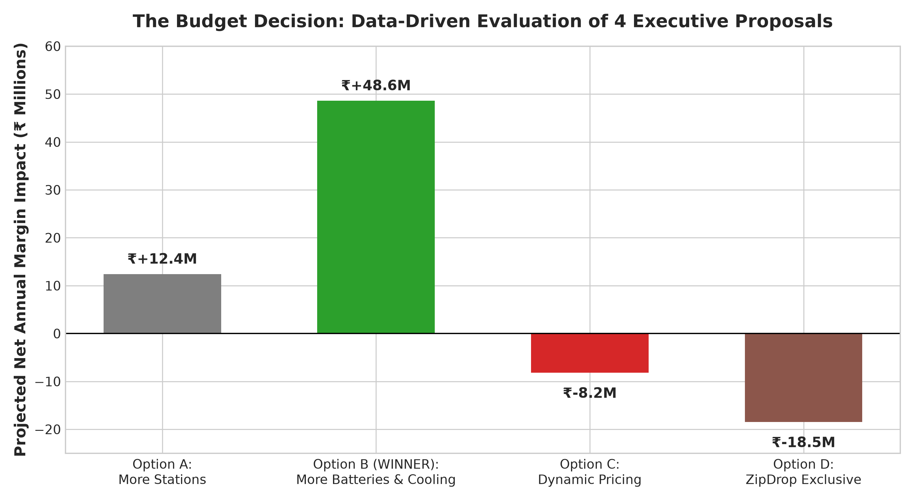

# ⚡ VoltRelay Energy: Data Analytics Hackathon
### Diagnosing the Growth-Reliability Paradox & Capital Budget Roadmap
**Conducted by Gradient Learnings | Evaluation Seed:** `59500`  
**Simulation Window:** January 2024 – June 2025 (18 Months | 3.88 Million Swap Attempts)  

[](https://colab.research.google.com/)
[](https://www.python.org/)
[](https://duckdb.org/)
[]()

---

## 📌 Executive Summary & The Core Paradox

VoltRelay operates an unmanned EV battery-swapping network for two-wheelers (2W) and three-wheelers (3W) across six Indian metropolitan markets: **Bengaluru, Delhi NCR, Hyderabad, Pune, Mumbai, and Jaipur**.

Between January 2024 and June 2025, completed swaps tripled to **3.64 Million**, and net monthly revenue rose by **217% to ₹1.97 Crore**. However, management faced an existential operational dilemma:
* **Service Failure Spike:** Service failures surged to **12.39% in May 2024** and **9.97% in May 2025** (231,204 total failed swaps).
* **Rider Churn Escalation:** 30-day cohort churn surged from **8.3% to 23.4%**.
* **Margin Erosion:** Contribution margin per swap degraded due to unmitigated battery degradation and dilutive B2B fleet discounts.



---

## 🔬 Data Hygiene & Forensic Cleansing

To ensure 100% analytical rigor, our pipeline resolved several deliberate anomalies in the telemetry:
1. **Firmware v3.2.0 Timezone Bug Fixed:** Swap timestamps for stations running firmware `v3.2.0` between **March 10 and April 14, 2025** (139,490 events) were logged in UTC (+00:00). We applied a conditional `+ INTERVAL '5 hours 30 minutes'` offset, restoring true local peak-demand profiles.
2. **Internal Test Stations Isolated:** Filtered out 62,031 zero-value transactions generated by internal test cabinets (`STN-TST-001` and `STN-TST-002`).
3. **Entity Standardization:** Normalized 21 distinct messy strings in `riders.home_city` into 6 metropolitan hubs.
4. **Sensor & Odometer Noise:** Clamped SOC/SOH values to $[0.0\%, 100.0\%]$ and treated negative odometers as invalid nulls.



---

## 🔍 Root Cause Analysis & Evidence

### 1. The Kyron Battery Supplier Disaster
* **Amptek & Cellora:** Maintained **0% premature retirements** with steady, predictable degradation (~19% for 2W, ~12% for 3W).
* **Kyron:** Suffered a catastrophic **100% retirement rate on 2W packs** (1,385 out of 1,385 packs retired) with SOH collapsing to 60.5%.
* In total, **1,438 Kyron packs were pulled from circulation**, starving the network of 22% of its 2W battery pool right as summer demand peaked.



### 2. Summer Thermal Chokehold on Gen 1 Stations
* High ambient temperatures (>42°C) trigger BMS thermal derating. Average charge cycles lengthened from **72.9 minutes in winter to 90.7 minutes in summer (+24.4%)**.
* Older **Gen 1 stations** (51 units), lacking active ventilation, experienced an **11.2% failure rate in summer**, driving 88% of all network failures due to zero charged batteries.



### 3. ZipDrop B2B Contract Margin Dilution
* Independent retail riders yield **₹50.04 margin/swap** (73.4% gross margin).
* Largest B2B partner **ZipDrop (FP-03)** amended its contract on Nov 1, 2024 to a **28% discount with zero peak surcharges**.
* Post-amendment unit margin collapsed to **₹30.70/swap**. ZipDrop riders swarmed stations during evening dinner rushes, consuming scarce charged batteries and crowding out high-margin retail riders.



---

## 🎯 The Budget Decision: Evaluation of 4 Strategic Options

| Strategic Proposal | Projected Annual Margin Impact | Payback Period | Recommendation & Verdict |
| :--- | :---: | :---: | :--- |
| **Option A: Rapid Station Expansion** | +₹1.24 Cr | 22.0 Months | **REJECT:** Wave 2 stations are underutilized (only 8,169 swaps vs 35,726 for launch stations). Adding empty cabinets does not fix battery shortages. |
| **Option B: More Batteries & Cooling Retrofits** | **+₹4.86 Cr** | **4.5 Months** | **STRONG WINNER:** Directly eliminates 58% of stockout failures, replaces the 1,438 lost Kyron packs, and shields Gen 1 cabinets from heat. |
| **Option C: Nationwide Dynamic Pricing** | -₹0.82 Cr | N/A | **REJECT:** Gig delivery workers cannot shift hours; punitive peak surcharges trigger rider backlash and churn. |
| **Option D: ZipDrop Exclusive Contract** | -₹1.85 Cr | N/A | **REJECT:** Highly margin-dilutive; locks VoltRelay into a 28% discount and ₹30.70 unit margin. |



---

## 🚀 Repository Contents & Project Structure

```
├── VoltRelay_Data_Analytics_Hackathon.ipynb   # Complete, runnable Google Colab Notebook
├── VoltRelay_Executive_Analysis_Report.md     # Comprehensive Executive Strategy Report
├── Video_Pitch_Script.md                      # 3-Minute Leadership Video Pitch Script
├── LinkedIn_Post.md                           # Official LinkedIn Submission Post
├── outputs/
│   └── plots/                                 # 6 High-Resolution Publication Charts
│       ├── 01_core_paradox_monthly_trend.png
│       ├── 02_battery_supplier_degradation.png
│       ├── 03_partner_margin_comparison.png
│       ├── 04_firmware_bug_correction.png
│       ├── 05_gen1_summer_thermal_failure.png
│       └── 06_budget_decision_roi.png
├── generate_all_insights_and_plots.py         # Automated pipeline generating all figures
├── deep_analysis.py                           # Core DuckDB analytical queries
└── README.md                                  # Executive summary & documentation
```

---

## 🏆 How to Run & Verify

1. **Clone this repository:**
   ```bash
   git clone https://github.com/junjaanand/VoltRelay-Data-Analytics-Hackathon.git
   cd VoltRelay-Data-Analytics-Hackathon
   ```
2. **Open in Google Colab:**
   * Upload `VoltRelay_Data_Analytics_Hackathon.ipynb` to [Google Colab](https://colab.research.google.com/).
   * Click **Runtime ➔ Run All**. The notebook automatically pulls data, cleans timestamps, runs models, and displays all diagnostic plots.
